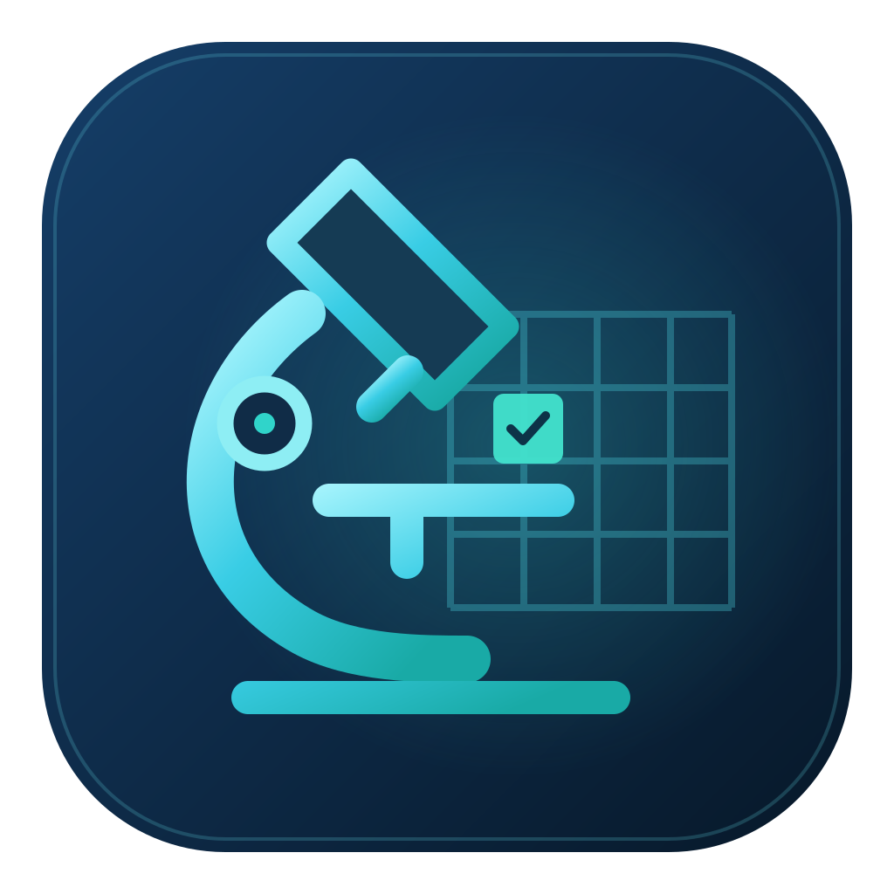
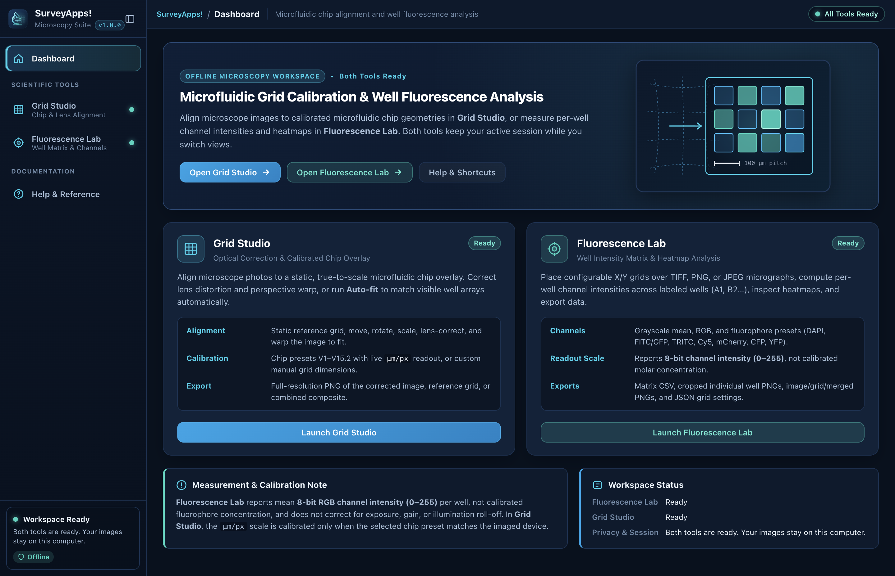
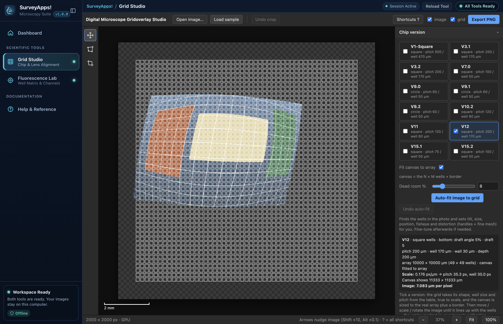
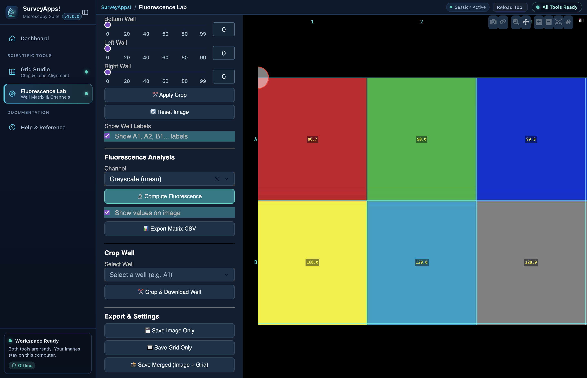

<p align="center">
  
</p>

<h1 align="center">SurveyApps!</h1>

<p align="center">
  <strong>Unified offline desktop suite for microfluidic chip grid calibration and well fluorescence analysis</strong>
</p>

<p align="center">
  macOS (Apple Silicon &amp; Intel) · Windows (x64) · 100% Offline · No Python or Node.js Setup Required
</p>

---

**SurveyApps!** packages two open-source microscopy tools into a single standalone desktop application:

1. **Grid Studio** — from [Digital-Microscope-Gridoverlay-Studio](https://github.com/zcays/Digital-Microscope-Gridoverlay-Studio)
   Calibrated chip grid overlays, lens fisheye correction, corner/edge distortion warp, cropping, computer-vision **Auto-fit**, and full-resolution PNG export.
2. **Fluorescence Lab** — from [Microscopy-Grid-Overlay](https://github.com/zcays/Microscopy-Grid-Overlay)
   Interactive X/Y grid placement on TIFF/PNG/JPEG micrographs, per-well fluorescence intensity calculation across channels (`DAPI`, `FITC`, `TRITC`, `Cy5`, `mCherry`, `CFP`, `YFP`, `RGB`, `Grayscale`), Plotly heatmaps, CSV/PNG/well-crop exports, and JSON grid settings save/load.

Both tools run completely offline on your computer with a bundled Electron runtime and a frozen local Python scientific engine (`Dash`, `Plotly`, `Pillow`, `NumPy`).

---

## Screenshots

| Dashboard | Grid Studio |
|---|---|
|  |  |

| Fluorescence Lab |
|---|
|  |

---

## Quick Download & Install

Pre-built downloads are published on the **[GitHub Releases](https://github.com/zcays/SurveyApps/releases)** page (and produced by the [Build SurveyApps workflow](.github/workflows/build-surveyapps.yml)).

| Platform | Recommended Download | Portable Alternative | Requirements |
|---|---|---|---|
| **macOS (Apple Silicon — M1/M2/M3/M4)** | `SurveyApps-1.0.0-mac-arm64.dmg` | `SurveyApps-1.0.0-mac-arm64.zip` | macOS 14.0+ |
| **macOS (Intel x64)** | `SurveyApps-1.0.0-mac-x64.dmg` | `SurveyApps-1.0.0-mac-x64.zip` | macOS 14.0+ |
| **Windows (64-bit x64)** | `SurveyApps-1.0.0-win-x64.exe` | `SurveyApps-1.0.0-win-x64.zip` | Windows 10/11 (64-bit) |

> **Full step-by-step instructions:** See **[INSTALL.md](INSTALL.md)** for macOS DMG/ZIP installation, Windows EXE/ZIP installation, SHA-256 verification, and unsigned-app approval steps.

### Important Notice for Unsigned Releases

- **macOS:** Releases are ad-hoc integrity signed (`codesign --verify --deep --strict`), **not** Developer ID signed or Apple notarized. If macOS Gatekeeper blocks the first launch, use **System Settings → Privacy & Security → Open Anyway** for a copy whose checksum you verified (do not disable System Integrity Protection).
- **Windows:** Windows builds are unsigned and may show a **Windows protected your PC** SmartScreen prompt. Click **More info → Run anyway** only after verifying the download checksum.

---

## Features & Scientific Workflows

### Unified Workspace
- **Persistent sessions:** Switch freely between **Dashboard**, **Grid Studio**, **Fluorescence Lab**, and **Help & Reference** without losing loaded images, grid alignment, or computed heatmaps.
- **100% local & private:** Zero external network requests, zero CDN assets, zero telemetry. The bundled Python backend binds only to `127.0.0.1` on an OS-assigned port with a per-launch authentication token and shuts down cleanly when the app exits.
- **Fault isolation:** If the Python analysis engine encounters an error, **Grid Studio** stays fully usable while you retry **Fluorescence Lab**.

### 1. Grid Studio (Optical Correction & Calibrated Chip Overlay)
- Load images via **Open image…**, drag-and-drop, clipboard paste, or **Load sample** (built-in fisheye test image).
- **Chip presets:** `V1-Square`, `V3.1`, `V3.2`, `V7.0`, `V9.0–V9.2`, `V10.2`, `V11`, `V12`, `V15.1`, `V15.2` with live `µm/px` calibration readout and automatic `N × M` array canvas sizing, or switch to manual grid dimensions.
- **Static grid, adjustable image:** Move (`V`), scale, rotate, arrow-key nudge, apply radial fisheye correction (`k₁`, `k₂`, lens center, `\` before/after toggle), distort corners/edges (`D`), and crop (`C`) without moving the reference grid.
- **Computer-vision Auto-fit (`A`):** Aligns visible regular well arrays automatically and refuses rather than guesses when residual error is too high.
- **GPU & CPU fallback:** Uses WebGL hardware rendering when available and automatically falls back to a matching Canvas 2D software renderer otherwise.
- **Export (`Ctrl/⌘+E`):** Full-resolution PNG of the corrected image, reference grid, or combined composite via native Save dialog.

### 2. Fluorescence Lab (Well Intensity Matrix & Heatmap Analysis)
- Upload **TIFF**, **PNG**, or **JPEG** microscopy images (EXIF orientation respected).
- Rotate the image, adjust orthogonal **X/Y spacing** and **origin center**, toggle well labels (`A1`, `B2`…), and tune line opacity.
- Choose **Grayscale (mean)**, isolated **Red / Green / Blue** channels, or fluorophore presets (**DAPI**, **FITC / GFP**, **TRITC / Texas Red**, **Cy5**, **mCherry**, **CFP**, **YFP**) and click **Compute Fluorescence**.
- **Measurement note:** Values represent **mean 8-bit digital channel intensities (`0–255`)**, not calibrated molar concentrations. Multi-page TIFFs read the first frame, and partial edge wells are excluded.
- **Exports & configs:** Export the well intensity matrix **CSV**, **Image Only PNG**, **Grid Only PNG**, **Merged (Image + Grid) PNG**, individual **Cropped Well PNGs**, and save/reload grid configurations as **JSON**.

### Keyboard Shortcuts

| Shortcut | Action |
|---|---|
| `Alt + 1` / `2` / `3` / `4` | Dashboard / Grid Studio / Fluorescence Lab / Help & Reference |
| `Ctrl/⌘ + B` | Collapse or expand sidebar |
| `V` / `D` / `C` | Grid Studio: Move / Distort / Crop tool |
| `A` | Grid Studio: Auto-fit image to selected chip grid |
| `← → ↑ ↓` | Grid Studio: Nudge image `1 px` (`Shift` = `10 px`, `Alt` = `0.1 px`) |
| `G` / `\` | Grid Studio: Toggle grid / Before-after fisheye toggle |
| `Ctrl/⌘ + O` / `E` | Grid Studio: Open image / Export PNG |
| `?` | Grid Studio: Show full in-app shortcut reference |

---

## Build from Source & Testing

End users do **not** need Python or Node.js. Developers building from source need:
- **Node.js `24.22.3`** (LTS)
- **Python `3.13.x`** (`3.13.13` pinned in CI)
- Platform-native build tools (Xcode Command Line Tools on macOS; MSVC / Windows SDK on Windows)

### Setup & Run Locally

```bash
git clone https://github.com/zcays/SurveyApps.git
cd SurveyApps

# 1. Python environment & frozen backend
python3 -m venv .venv
# macOS / Linux:
source .venv/bin/activate
# Windows PowerShell:
# .venv\Scripts\Activate.ps1

python -m pip install -r requirements-build.txt

# 2. Node dependencies & icons
npm ci
node scripts/build_icons.cjs
python scripts/build_icon_formats.py

# 3. Freeze local Python backend and launch in dev mode
python scripts/build_backend.py
npm start
```

### Package Installers

- **macOS (Apple Silicon ARM64):**
  ```bash
  CSC_IDENTITY_AUTO_DISCOVERY=false npm run build:mac
  ```
  Outputs `dist/SurveyApps-1.0.0-mac-arm64.dmg` and `dist/SurveyApps-1.0.0-mac-arm64.zip`.

- **macOS (Intel x64 on Apple Silicon via Rosetta + x64 Python):**
  ```bash
  arch -x86_64 .venv-x64/bin/python scripts/build_backend.py --distpath build/backend-x64
  CSC_IDENTITY_AUTO_DISCOVERY=false node scripts/package_intel.cjs
  ```
  (On native Intel hardware or CI `macos-15-intel`, run `python scripts/build_backend.py` and `npx electron-builder --mac --x64 --publish never`.)

- **Windows (x64):**
  ```powershell
  python scripts/build_backend.py
  npm run build:win
  ```
  Outputs `dist/SurveyApps-1.0.0-win-x64.exe` (NSIS installer) and `dist/SurveyApps-1.0.0-win-x64.zip` (portable archive).

### Automated Tests

```bash
# Python scientific & backend service unit tests (8/8)
python -m unittest discover -s tests -p "test_*.py" -v

# Backend startup error & idempotent cleanup test
node tests/backend-lifecycle.cjs

# Full Electron + Playwright E2E suite (dev or packaged binary)
npm run test:desktop
node tests/desktop.cjs --packaged
```

See **[docs/VALIDATION.md](docs/VALIDATION.md)** for complete test evidence and platform verification status.

---

## Project Structure & Documentation

```text
SurveyApps/
├── .github/workflows/build-surveyapps.yml  # Cross-platform macOS (arm64/x64) & Windows (x64) CI build
├── assets/                                 # SVG master + 1024/2048 PNG + ICNS + ICO icons
├── backend/                                # Python FastAPI/Flask/Dash server & Fluorescence Lab runtime
├── desktop/                                # Electron main process, preload bridge, backend manager
├── docs/
│   ├── ARCHITECTURE.md                     # Stack evaluation, IPC bridge, security model
│   ├── UPSTREAM_CHANGES.md                 # Minimal runtime patches & scientific limits
│   ├── VALIDATION.md                       # Verified test results & build matrix
│   └── images/                             # Application screenshots
├── renderer/                               # Unified dashboard, navigation, Help & status UI
├── scripts/                                # Icon rasterizers, PyInstaller freeze, packaging helpers
├── tests/                                  # Python science tests & Playwright E2E desktop suite
├── vendor/                                 # Pinned upstream snapshots, provenance.json & patches
├── INSTALL.md                              # Detailed user installation & troubleshooting guide
├── package.json                            # Electron & electron-builder configuration
└── requirements-build.txt                  # Pinned Python build/runtime dependencies
```

- **[INSTALL.md](INSTALL.md)** — End-user download, install, checksum verification, and OS approval guide
- **[docs/ARCHITECTURE.md](docs/ARCHITECTURE.md)** — Desktop architecture, IPC contract, and security isolation
- **[docs/UPSTREAM_CHANGES.md](docs/UPSTREAM_CHANGES.md)** — Preserved upstream sources, patches, and scientific caveats
- **[docs/VALIDATION.md](docs/VALIDATION.md)** — Test coverage, platform build matrix, and known limits

---

## Provenance & Licensing

SurveyApps! integrates pinned snapshots of:
- [`zcays/Digital-Microscope-Gridoverlay-Studio`](https://github.com/zcays/Digital-Microscope-Gridoverlay-Studio)
- [`zcays/Microscopy-Grid-Overlay`](https://github.com/zcays/Microscopy-Grid-Overlay)

Full commit hashes, file checksums, and reconstruction patches are recorded in [`vendor/provenance.json`](vendor/provenance.json). Neither upstream snapshot included an explicit `LICENSE` file; third-party bundled runtimes (Electron, Chromium, Python, Dash, Plotly, Pillow, NumPy) retain their respective open-source licenses.
